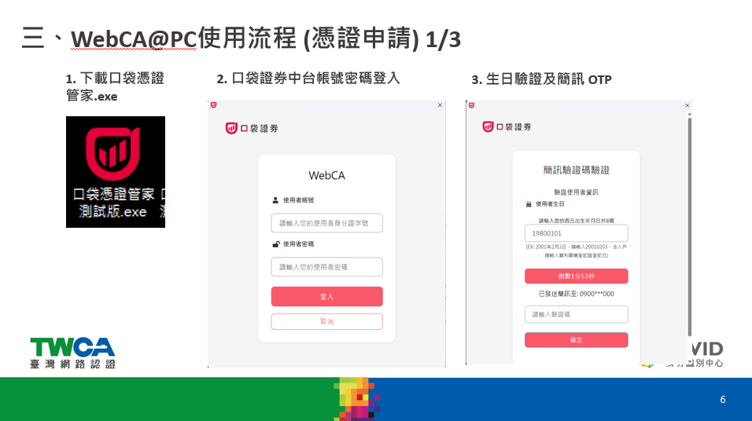
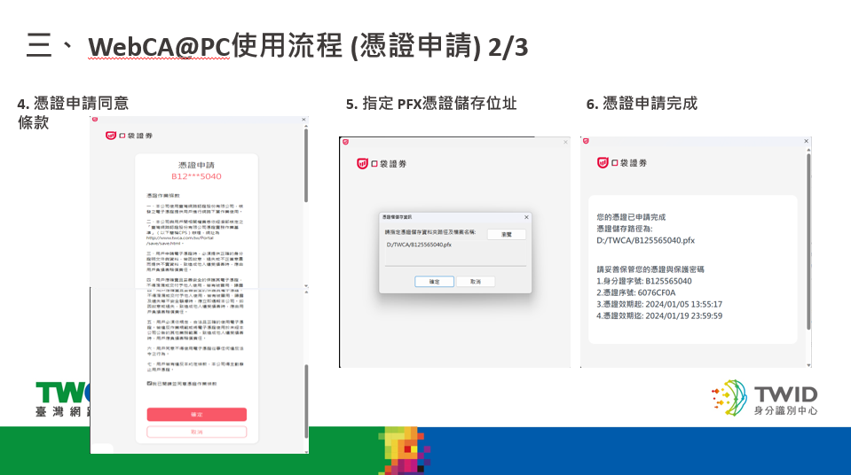

# 事前準備

使用 SDK 前，請先擁有口袋證券帳戶，並完成文件簽署以取得 API Key。

開戶請見 [口袋開戶](https://www.pocket.tw/openaccountonline/oa/home?mkCode=MK0000&channel=CH0003&utm_source=pocketw&openExternalBrowser=1&showYuShanBtn=Y)。

下單前需要憑證檔（`.pfx`）。憑證簽章目前僅支援 Windows。請用口袋憑證管家（WebCA@PC）申請。

## 安裝

=== "Python"

    Python 3.9：

    ```bash
    pip install pocketx
    ```

=== "C#"

    請使用公司提供的 PocketxSDK 套件。憑證簽章需在 Windows 執行。

## 憑證申請

### 下載、登入與驗證

1. 下載並開啟口袋憑證管家。
2. 以使用者帳號（身分證字號）與使用者密碼登入。
3. 完成生日驗證，並輸入簡訊 OTP。



### 同意條款並儲存 PFX

4. 閱讀並同意憑證申請條款。
5. 指定 PFX 的儲存路徑與檔名，例如 `D:\TWCA\你的身分證字號.pfx`。
6. 申請完成後，請保存憑證路徑、憑證密碼與效期。之後在 SDK 呼叫 `activate_ca`（Python）或 `ca_activate`（C#）時會用到這個檔案。


